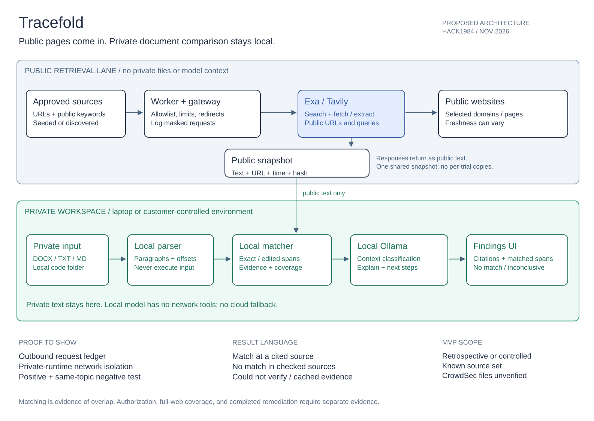

# Tracefold — product and build plan

Decision record: November 7, 2026. Authors of the project: Kaviish Sethi and Ahaan Kallat. This document captures the discussion and turns it into a proposed implementation. Requirements below are plans, not claims that the software already works.

## 1. What we are building

**Pitch:** Tracefold checks selected public sources for copies of your private documents, shows the evidence, and helps you decide what to do next—without sending your documents to a search provider or hosted model.

The first user is a security or platform engineer at a small software business. They have a roadmap, proposal, internal engineering document, or code folder and want to know whether distinctive passages appear on public pages. The first supported workflow is an on-demand check with visible coverage. Continuous whole-web monitoring is a future hypothesis, not the demo promise.

The product has four useful outputs:

1. An evidence-backed match: local file and span, public URL and span, retrieval time, and matching method.
2. An honest negative or incomplete result: which sources were checked, which failed, and what the comparison did not cover.
3. A locally generated explanation and suggested remediation, grounded in those observations.
4. A local preventive risk review of the submitted code or documents, including when no public match is found, with evidence locations and suggested fixes.

The product does not establish who published the content, whether publication was authorized, or whether a credential works. A human supplies business context and makes the incident decision.

## 2. Why the original direction changed

Spillway combined a public fingerprint index, hash-prefix lookup, a hash-only vault, verification, and egress auditing. Its recorded experiments demonstrated live ingestion and matching for a planted Gist, but did not establish reliable discovery for arbitrary companies. More search results often meant tutorials and example code, not attributable company exposures.

The recorded broad sweep reported 55 provider-pattern credential candidates across 21 pages, with all of those candidates attributed to Gists in its aggregate report. These were format judgments, not active-credential tests or verified company incidents. The additional Pastebin links were detector hits. Individual GitHub accounts could not be presented as company leaks without separate attribution.

Tracefold changes the starting point from “enter a company and we will find its leaks” to “compare this private material with these public sources.” The user explicitly accepts a retrospective case study and a known source set for the demonstration. The result must still be calculated by the working system; it must not be a hardcoded finding.

This repo starts clean. No encrypted public bucket service, decoys, manual API-key vault, mocked DNS verification, marketing/pricing pages, cloud-model verification, or broad breach-news dashboard is required for the first build. The old frozen contracts belong to the old repository.

## 3. Proposed architecture

[Open the editable Excalidraw source](docs/architecture.excalidraw). The diagram depicts the intended system, including the privacy boundary; it is not a deployment inventory.

### Private workspace

A local web UI talks to a local backend. For a hosted deployment, both must remain inside the customer's explicitly trusted environment; uploading a document to a vendor-operated backend would change the privacy claim.

Private input → local parser → local text/fingerprints → local matching → local Ollama explanation → local findings UI.

Start with DOCX and UTF-8 TXT/Markdown. Support a local folder of selected text/code files next. A GitHub repository can be a source of reference files, but importing an already-public repository does not establish that it was private before. Do not run imported code, install its dependencies, follow symlinks outside the chosen folder, or execute document macros. Defer scanned PDF/OCR and large binary artifacts.

The parser extracts paragraphs and source offsets. Keep raw private text in memory for the scan and in the local model context; do not put it in application logs or public caches. A filename can itself be sensitive. Saved local evidence should use opaque document IDs by default, with an explicit user choice for retaining snippets. This architecture deliberately does **not** claim that an LLM can compare arbitrary documents from hashes alone.

### Public retrieval worker

The network-enabled worker receives a public source manifest: approved domains/URLs, public company identity where useful, generic queries, page limits, freshness policy, and provider choice. Its job is to retrieve candidate pages using Exa and/or Tavily and return bounded text with provenance.

There are two source modes:

- **Seeded mode, required:** fetch known public URLs. Reliable for the controlled demo. This proves retrieval and matching, not independent discovery.
- **Discovery mode, optional:** search selected domains using public company information and predeclared generic terms, then fetch candidate URLs. Show whether a URL was seeded or discovered.

Build the public snapshot beforehand or refresh it at scan time; both are valid. The demo should show at least one fresh retrieval and distinguish it from cached evidence. A failed refresh leaves a stale observation, not proof that content remains live or has been removed.

### Separation that makes the privacy claim plausible

Run the public worker as a separate process with no private-document filesystem mount and no access to the local model context. Its input schema accepts source IDs and approved public queries, not arbitrary model-generated strings. The local classifier cannot call a search tool containing private context. A narrow orchestrator can choose a public source ID for a refresh without passing private text.

All outbound application HTTP goes through one gateway. Enforce destination and redirect checks, request-size limits, purpose labels, and a request ledger. For direct fetches, reject private/reserved network addresses and unexpected redirect targets. Provider API keys remain local configuration and must be masked in logs.

Use a downloaded Ollama model through a loopback endpoint with cloud features disabled. No hosted embeddings, cloud model fallback, or third-party document parser. For stronger proof, deny outbound network access from the private processing/model runtime and allow it only for the public worker. Treat this as a build acceptance check, not a security property established by merely installing Ollama.

**What may leave:** approved public queries, public URLs, provider authentication, normal network metadata, and request timing. Selected URLs may reveal which public material interests the user. **What must not leave:** private document text, identifying filenames, local snippets, embeddings, fingerprints, or document-derived search terms. Don't claim “nothing leaves the device.”

Rewording or obfuscating a sensitive passage is not a privacy guarantee: its meaning may remain identifiable. The demo avoids that problem by defining retrieval inputs independently of private content. An exact-term blocking test and ledger can support inspection, but neither proves universal resistance to exfiltration.

## 4. How detection works, and why

### Evidence first

Normalize local and retrieved text consistently: Unicode normalization, whitespace, paragraph boundaries, and a documented policy for case and punctuation. Preserve original offsets for evidence display. Code deserves a separate normalization policy so meaningful syntax is not silently discarded.

First implement exact passage detection using token shingles and contiguous-span confirmation. Shared hashes identify candidates; comparison of actual local text confirms spans and avoids treating hash matches alone as proof. Require a meaningful minimum span, downweight boilerplate, and report both matched token count and coverage of the reference segment.

Next, add edited-passage matching using overlapping chunks and token alignment. Pick thresholds on a development fixture set and freeze them before evaluation. Do not claim robust paraphrase detection until measured. Two documents about the same topic are not necessarily copies, and a shared license header is not a sensitive leak.

### Useful role for the local model

Ollama can classify document type, flag apparently sensitive context, distinguish plausible boilerplate from substantive text for reviewer attention, explain the supplied match evidence, and suggest platform-appropriate actions. Store the model tag, model digest when available, prompt version, and returned classification with the local result.

The matcher owns evidence. The model may recommend review or downgrade a candidate, but cannot manufacture a matched span, URL, confirmed exposure, or completed remediation. Unsupported model output is discarded. If Ollama is unavailable, deterministic matches still render and the explanation panel reports unavailability.

Treat all document and web text as untrusted data. The model has no shell or arbitrary network tools. Its schema returns bounded classifications and references to supplied evidence IDs. Prompt-like text inside a retrieved page is not an instruction to the system.

### Preventive review when no public match is found

Addition agreed November 7: a no-match result must still offer useful feedback on potential vulnerabilities and data-exposure risks in the submitted material. Run this review locally through Ollama, supported by small deterministic checks where appropriate. It may also accompany a public match; public exposure and local risk are separate result dimensions.

The review reads the parsed private input, not just match evidence. For the first build, focus on a bounded set of reviewable issues: apparent embedded secrets, sensitive personal or business data that may need redaction before sharing, sensitive values written to logs, and code/configuration patterns suggesting overly broad access or unsafe handling of input. A document's containing sensitive information is not by itself a vulnerability: explain the sharing or deployment condition that creates the risk. Do not claim a comprehensive security audit or infer runtime behavior from missing context.

Each finding must include:

- Category and status: rule-supported finding or model-suggested concern requiring review.
- Local file/paragraph or line reference and the specific evidence behind the concern. Mask apparent secret values in results and omit them from logs.
- What could go wrong, under what conditions, and what context is missing.
- Suggested fix tied to that evidence, plus a concrete local recheck or manual verification step.
- Severity rationale and uncertainty; avoid unsupported numerical confidence scores.

Validate that cited locations exist before displaying a finding. A valid location does not prove the model's interpretation, so retain the review label for model-only concerns. Never invent a vulnerability, exploitability claim, or CVE. No code execution, credential testing, external scanning, or automated edits are required for this review. Treat embedded instructions as data and keep the review within the existing no-egress model boundary.

The result screen has two sections: **Public exposure** and **Potential risks in your files**. For example: “No match in 12 checked sources” alongside “Potential sensitive-data logging at app.py:42 — redact the field before logging and verify the resulting log output.” This is an illustrative fixture, not a finding from a real scan.

If no risks are identified, say “No potential risks identified by this review,” with the files/checks covered and limitations. If the model fails, say “Risk review unavailable”; preserve the independent public-match result. Do not use “safe” or “no vulnerabilities.” Suggested changes remain proposals until the user applies and verifies them.

### Why the proposed positive and negative demo should work

If the local reference contains a distinctive passage also returned from a public source, normalization plus span matching can establish the overlap. If a second document contains no qualifying overlap in that same snapshot, the result can correctly report no match **within that snapshot**. A same-topic negative checks that the system isn't simply reporting topical similarity.

This reasoning depends on successful extraction, source coverage, and calibrated thresholds. It is not empirical validation yet. It does not establish publication authorization, detect every transformed copy, or prove absence across the internet.

## 5. User flow and states

1. **Choose sources:** show URLs/domains, seeded versus discovery mode, limits, and expected external requests.
2. **Import reference:** document or folder; local extraction preview and unsupported-file errors.
3. **Check:** show extraction, retrieval, indexing, matching, and local analysis as real steps. No simulated progress disguised as execution.
4. **Review:** separate public-exposure evidence from potential risks in the local files. Show source citations, side-by-side spans, coverage and freshness for matches; show local locations, conditions, uncertainty and fixes for preventive findings. Offer the local review even when no public match exists.
5. **Act:** a suggested checklist and recheck button. The system never silently sends takedown notices, rotates credentials, or marks work complete.
6. **Inspect privacy:** show outbound destinations, approved query/URL payloads, purpose, timing, and masked authentication.

Result vocabulary:

| State | Meaning |
|---|---|
| Matching content found publicly | A qualifying span was observed at the cited source; authorization is a separate question. |
| No match in checked sources | No qualifying match in successfully retrieved content; include coverage. |
| Could not verify | Retrieval or parsing failed; do not count as clean. |
| Cached evidence | Match belongs to a dated snapshot, not a verified current page. |
| No longer observed at this URL | A fresh successful retrieval no longer contains the matching passage. A 403, timeout, or parser error cannot establish removal. |

Actions depend on context: restrict a public document, remove an exposed copy, contact its owner, investigate publication history, and recheck occurrences. Only suggest credential rotation where credential exposure is actually implicated. A checklist is advice, not proof that anything was fixed.

## 6. Case-study decision and provenance

**CrowdSec is the user's selected fallback. It is not yet a validated demo dataset.** Its [September 18 incident analysis](https://www.crowdsec.net/blog/tanstack-supply-chain-attack-analysis) confirms copied private repositories and a later public archive. The follow-up report also identifies personal information in the archive. Its intentionally open-source engine is not the private-code exposure.

The bounded follow-up search found no stronger alternative satisfying all four gates: smaller company, attributable unintended exposure, currently accessible files, and a verified reference/public-copy pair. The [research record](research/case-study-research.json) preserves the decision and sources.

Alternatives considered:

- Google and Anthropic: explicitly rejected by the user as obvious giant-company examples.
- Rabbit: confirmed incident, but no authenticated accessible sample pair verified; do not conflate distinct incidents.
- TeleMessage: accessible attributable source, but company-published open source does not establish unintended private-code exposure.
- Geedge: documented exposure; checked research artifacts contain measurements rather than a verified original-file pair for this demo.
- Proton memo: company-published material could exercise matching, but authorized publication must not be called a leak.

Before using real files, record the attribution evidence, original public location, acquisition time, stable content hash, observed publication history where available, and the exact public counterpart. Review a small non-personal sample; never test credentials. Avoid large archives, user records, and speculative company attribution. A mirror's description alone does not authenticate its contents.

If no usable CrowdSec pair is verified before the demo freeze, present the confirmed incident as motivation and use an explicitly labeled controlled reconstruction. Do not imply that synthetic files are CrowdSec material. A permitted retrospective sample proves matching against a known exposure, not discovery of a previously unknown customer incident.

## 7. Three-minute demonstration

- **0:00–0:20 — Problem:** introduce the need to check a private document without uploading it to another service. Label the case retrospective or controlled.
- **0:20–0:45 — Scope:** show the source list and import the positive reference. Explain that these are monitored sources, not the entire web.
- **0:45–1:30 — Evidence:** live-refresh at least one page, compute the match, open the side-by-side passage and citation, and show the retrieval time.
- **1:30–2:00 — Contrast:** import the negative document against the same snapshot. Show no match and the number of sources checked, then a separately labeled local risk and suggested fix in that unpublished fixture. Prefer a same-topic negative over an obviously unrelated one; use an intentionally risky synthetic fixture, not an actual credential.
- **2:00–2:35 — Privacy and assistance:** inspect the outbound requests and local Ollama response. The document stayed in the private processing environment; the public source URLs did not.
- **2:35–3:00 — Action and buyer:** show actionable next steps and one recheck. Name the initial customer and the coverage limitation.

Optional memorable beat: publish two controlled copies, remove one, and demonstrate that the remaining occurrence prevents closing the incident. This is a stretch, not a requirement to delay the basic flow.

Freeze a reproducible public snapshot for a Wi-Fi-off fallback and label replayed evidence with its original timestamp. Record one backup video after the live path works. Neither should masquerade as fresh retrieval.

## 8. Hackathon track fit

Track descriptions checked November 7 against the [official HACK1984 page](https://claudeneu.com/hackathon/). These assessments are our interpretation, not eligibility approval or predicted judging outcomes. Confirm whether multiple-track entry is allowed with organizers.

| Track | Fit | What our demo must demonstrate |
|---|---|---|
| Privacy-First | Primary; strongest fit | Local parsing, matching, and model inference; explicit outbound boundary; inspectable requests; no hosted-model fallback. |
| Surge — Tavily / Exa | Strong if retrieval and verification are central | Real provider retrieval, citations, freshness, and a bounded verification agent choosing from approved public source IDs. A static index alone is a weaker showing. |
| Most Startup-able | Plausible, unvalidated | A named buyer segment, useful outcome, realistic source coverage, simple onboarding, and a reason to pay. Do not invent customers, revenue, or pricing validation. |
| Signal-to-Dose — Within3 | Not targeted | This is a life-sciences launch-intelligence track; the current product does not address that workflow. |

The preventive review adds practical value when monitored sources yield no match and strengthens the usefulness story for Privacy-First and Most Startup-able. It does not itself establish Surge fit; that still depends on the public retrieval workflow.

The privacy track asks for evidence about data leaving the device and practical usefulness. Surge centers agentic web research with sources. The startup prize centers customer and company potential. We should prioritize a working private comparison over features added solely to mention sponsors.

## 9. Credibility and evaluation

Use one immutable public snapshot with distinct development and evaluation fixtures. A 12-document sanity check is enough to expose obvious mistakes, not enough for a production accuracy claim:

- 3 exact copied passages.
- 3 edited copies.
- 3 same-topic documents without distinctive copied passages.
- 3 unrelated documents.

For the preventive review, add a small labeled set covering an unpublished risky file, its corrected counterpart, benign lookalikes, missing deployment context, fabricated evidence locations, and model failure. Reuse tiny fixtures where suitable. Check finding relevance, location accuracy, useful fixes, and false alarms separately from public-match accuracy. A no-match result must not suppress risk findings; a risk finding must not change no-match into a confirmed leak.

Keep the evaluation documents unseen during threshold tuning. Record expected versus actual matches, false positives, misses, matched-span quality, retrieval failures, model failures, scan time, provider calls, snapshot version, matcher version, and local model identity. Report exact counts, not inflated percentage claims. Duplicate copies of the same passage are not independent evaluation examples.

Verify the privacy boundary with a unique synthetic private marker absent from public sources. Inspect request construction and the recorded outbound payloads, and test the private runtime under denied outbound networking. Include timeout/403 behavior, same-topic negatives, boilerplate, and a document containing an instruction to upload its contents. The latter must remain inert data.

Acceptance criteria: positive evidence appears; negative result names coverage; failures remain inconclusive; private text never enters worker requests; local model failure doesn't erase matches; every public citation maps to a stored retrieval observation; preventive findings cite valid local locations and retain uncertainty; review failures are visible and do not alter the public-match result. No performance or privacy test has been run in this new repo yet.

## 10. Build order and proposed responsibilities

Assignments are a proposal for Kaviish and Ahaan to agree on, not a claim that either has accepted a task.

1. **Agree the demo pair and source manifest.** Kaviish: retrieval/provenance. Ahaan: input/results flow. Decide fixture labels before styling.
2. **Build a CLI vertical slice.** DOCX/text extraction, one public retrieval, local matching, evidence JSON. Start with a tiny source set.
3. **Enforce the boundary.** Separate worker, gateway, request schema, local model configuration, bounded storage, failure states.
4. **Add local analysis.** Match explanations constrained to supplied evidence, plus a separate preventive review of private files with validated local references, bounded checks, uncertainty, and suggested fixes. Include the no-public-match path. Pin model after checking available RAM/disk and a small timing pilot.
5. **Wire the UI.** Import → sources → scan → evidence → next steps → egress. Real state changes, no fake results.
6. **Evaluate and rehearse.** Run the small frozen set once, fix meaningful failures, record backup. Avoid repeatedly broadening searches instead of validating the core.

Suggested stack: Python 3.11+ and FastAPI for local backend/worker; SQLite for provenance and result metadata; Next.js for the UI; Ollama for local inference; thin gateway-backed Exa/Tavily REST adapters. Exact dependencies and the local model are implementation choices, not installed by this planning task.

## 11. Storage, cost, and scope limits

Initial proposed pilot: at most 20 public pages, 10 reference files, 200 KB extracted text per page, and a 50 MB combined text/index cache. Cap provider requests at 40 per run, concurrency at 2, and wall time at 5 minutes with explicit timeout results. These are limits to implement, not measured costs. Check provider billing before expansion.

Keep one content-addressed public snapshot per data version. Store per-run results separately; no full database or application copy per trial. Keep at most the latest three disposable debug traces with private content omitted. Measure input size, free disk, and first-run growth before increasing any limit. Model weights require a separate measured budget and should be downloaded once, never per trial. Preserve original user files and unique evidence; clean only known agent-created disposable artifacts.

This planning repository should stay under 2 MB, excluding Git internals, with no dependencies, model weights, datasets, or screenshots of third-party leaks. Never commit environment secrets, customer documents, private databases, or leaked credential values.

## 12. Technical references

- [Ollama FAQ, official source](https://github.com/ollama/ollama/blob/main/docs/faq.mdx): local-only configuration and cloud-feature controls. Configure `OLLAMA_NO_CLOUD=1` in the model service and confirm the effective runtime setting; this is not a substitute for network isolation.
- [Exa official contents reference](https://github.com/exa-labs/agent-skills/blob/main/skills/build-with-exa/references/contents.md): retrieving known public pages and freshness controls. Check the current request schema before implementation.
- [Tavily extraction guide](https://help.tavily.com/articles/3363168593-extracting-web-content-using-tavily): public content extraction. Provider extraction is not evidence of whole-web completeness.
- [HACK1984](https://claudeneu.com/hackathon/): track descriptions.
- [CrowdSec incident analysis](https://www.crowdsec.net/blog/tanstack-supply-chain-attack-analysis): fallback incident provenance, not a supplied demo dataset.
