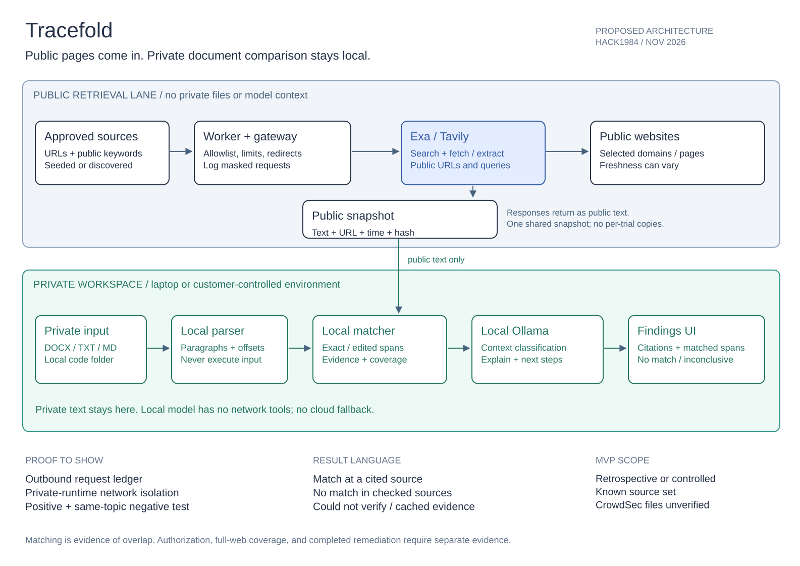

# Tracefold

Find public copies of private documents. Keep the comparison local.

Tracefold is a new HACK1984 project: import a document or a local source folder, check a defined set of public sources, and inspect cited passage matches plus locally generated next steps. Public pages come into the customer's environment; private document text is not sent to search providers or hosted models.

**Status: design and demo plan only. No application has been implemented or validated in this repository.**

- [Complete product, architecture, demo, and track plan](PLAN.md)
- [Editable Excalidraw architecture](docs/architecture.excalidraw) — download and open in [Excalidraw](https://excalidraw.com).
- [Architecture preview](docs/architecture.svg)
- [Risk-review workflow informed by 0sec](research/0sec-risk-review.md)
- [Case-study research and CrowdSec fallback](research/case-study-research.json)

## The first demo

1. Choose public sources and import a local reference document.
2. Refresh the sources through Exa or Tavily without sending the reference document.
3. Compute passage matches locally; show the source, matched span, coverage, and retrieval time.
4. Use a local Ollama model to explain matches and review the files for potential vulnerabilities or data-exposure risks, with local evidence and suggested fixes.
5. Show an unpublished document with no public match but a separately labeled potential risk, its suggested fix, and the outbound-request ledger.

The result is **“matching content found publicly”** or **“no match in the sources checked,”** never a blanket assurance that a company is safe. A separate **Potential risks in your files** section provides preventive feedback even when no public match is found. These are review findings, not proof of a leak or a comprehensive security audit.

## Isolation from Spillway

This is a standalone repository and a new implementation plan. It does not copy Spillway's application, databases, credentials, Git history, or frozen interfaces. Only the case-study decision record is carried forward as small research metadata. Any future code reuse must be selected and reviewed explicitly.

Working name: Tracefold; no trademark or domain-availability claim is made.
