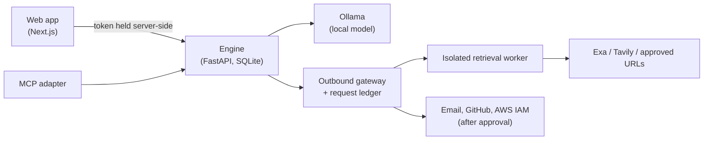

# Tracefold

Tracefold finds where private company material has been copied to public sites, flags risky content in files before it ships, and drafts the remediation for a person to approve.

It runs inside your own environment. Files are parsed and reviewed locally, model review uses a local Ollama model, and every outbound request (search, page fetch, email, cloud API) goes through one gateway and is recorded per scan.

## What it does

- **Public exposure.** Compares uploaded documents and code against public pages, found either by searching on the company's approved name (Exa or Tavily) or from an explicit list of URLs. Results show the matching passages with their source and retrieval time.
- **Potential risks in files.** Checks the same files for embedded secrets (built-in rules plus optional [Gitleaks](docs/GITLEAKS.md)), sensitive values written to logs, confidentiality markers, personal identifiers and regulated data for the company's industry. A local model reviews each rule hit against the cited lines.
- **Fix and recheck.** A finding can be rechecked against a new version of the file. The result is `still_detected`, `not_detected_in_checked_version` or `inconclusive`.
- **Approval-gated remediation.** For a public copy, Tracefold drafts a takedown request to the host. For a leaked GitHub token or AWS access key, it drafts a revocation. Nothing is sent or changed until a named person approves it.
- **Coding assistants.** An [MCP server](adapters/mcp/README.md) lets assistants such as Claude Code scan their changes, read findings and recheck fixes before reporting work as done. Assistants cannot approve remediation.
- **Scheduled checks.** Re-run a scan's files or a workspace's uncommitted changes hourly, daily or weekly.

Results are reported in exact terms: "matching content found publicly" or "no match in the sources checked". Tracefold does not claim whole-web coverage or declare a file safe.

## Architecture



The web app and MCP adapter are thin HTTP clients. Parsing, detection, model calls and findings all live in the engine. See [docs/ARCHITECTURE.md](docs/ARCHITECTURE.md).

| Path | Contents |
|---|---|
| [`server/`](server/README.md) | Engine: API, scan pipeline, checks, discovery, retrieval, remediation |
| [`frontend/`](frontend/README.md) | Web app for uploads, findings, approvals and settings |
| [`adapters/mcp/`](adapters/mcp/README.md) | MCP server for coding assistants |
| [`docs/`](docs) | Architecture, API reference, discovery, deployment, benchmark results |

## Getting started

Requirements: Python 3.11+ with [uv](https://docs.astral.sh/uv/), Node 20+ and Git. Ollama is optional but recommended.

```bash
cd server && uv sync && uv run tracefold quickstart --root /path/to/folder \
  --company "Your Company, Inc." --domain yourcompany.com --reply-to legal@yourcompany.com
```

```bash
cd server && uv run tracefold serve --port 8787
```

```bash
cd frontend && npm install && npm run dev
```

Then open http://localhost:3000. [SETUP.md](SETUP.md) covers each step, connecting a coding assistant, and configuring takedowns and key revocation. To run everything in your own network with Docker, see [docs/DEPLOY.md](docs/DEPLOY.md).

## Documentation

- [Setup](SETUP.md)
- [Architecture](docs/ARCHITECTURE.md)
- [Engine API](docs/ENGINE_API.md) (machine-readable: [`server/openapi.json`](server/openapi.json))
- [Company-name discovery](docs/DISCOVERY.md)
- [Gitleaks integration](docs/GITLEAKS.md)
- [Deployment](docs/DEPLOY.md)
- [Discovery benchmark](docs/benchmark/README.md)

## Tests

```bash
cd server && uv run pytest -q
```

```bash
cd adapters/mcp && uv run pytest -q
```

The engine suite runs offline. Live provider and local-model tests are opt-in; see [server/README.md](server/README.md#tests).

## Privacy model

- The engine binds to loopback by default, requires a client token on every request and checks `Host` and `Origin` headers.
- File text goes to a model only if that model is on 127.0.0.1.
- Public retrieval runs in a separate worker. Search queries fill fixed templates with an approved company name, or with names inferred locally when automatic discovery is on. File text is not sent to search providers.
- Each client grant has a disclosure level. A `minimal` grant (for cloud-backed assistants) withholds paths, explanations and evidence text.
- Tool results returned to a cloud-backed assistant reach that assistant's model provider. For a fully private setup, use an MCP host that runs a local model.
