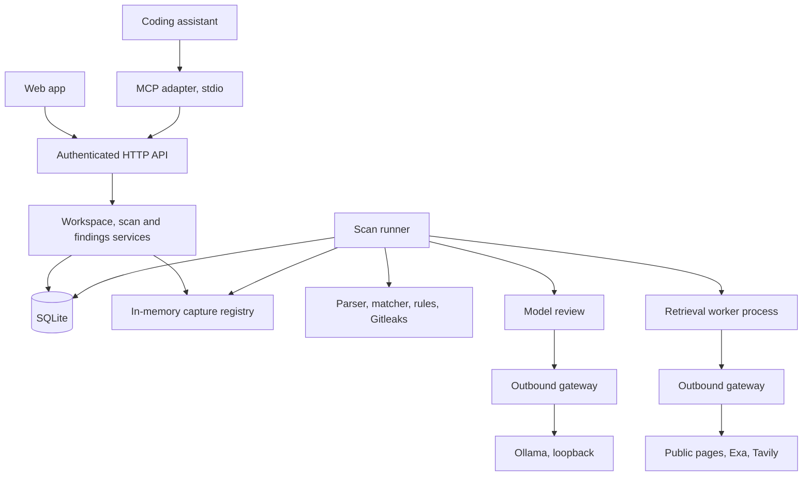

# Tracefold engine architecture

The Tracefold engine is one local server that owns workspace authorization, input capture, scan execution,
evidence, findings and rechecks. The web app (`frontend/`) and the MCP adapter (`adapters/mcp/`) are HTTP clients
of this server. Neither client parses files, calls a model, assigns severity or keeps its own findings database.

This document describes how the engine is built. For request and response details see
[`ENGINE_API.md`](ENGINE_API.md) and the generated contract in [`server/openapi.json`](../server/openapi.json).

## Stack

| Area | Implementation |
|---|---|
| Language | Python 3.11+, managed with uv |
| HTTP boundary | FastAPI with Pydantic request/response models, exported as OpenAPI |
| Persistence | One SQLite database with schema migrations and short transactions |
| Execution | One API process and one supervised scan runner; one active scan at a time |
| Public retrieval | Separate worker process that receives only approved public URLs or approved queries |
| Model review | One local Ollama model on loopback, JSON-schema outputs, server-side validation |
| Client updates | Polling of scan status endpoints |
| Fixes | Read-only scanning; the engine returns a suggested change and a recheck target, and never edits files |

## Components



The module layout is listed in [`server/README.md`](../server/README.md#layout). Two structural rules hold
throughout the code:

- Only `storage/` executes SQL.
- Only `gateway/` makes HTTP requests, including loopback calls to Ollama, which use a separate local-model policy.

All callers go through the same service-layer authorization and disclosure policy. Credentials and raw private
text are not written to logs or error messages.

## Authorization and privacy boundaries

**Provisioning.** Workspaces, client tokens, grants and public-source manifests are created by an operator with
the `tracefold` CLI. No HTTP route can register a filesystem root or a manifest, and a client cannot widen its own
permissions through request arguments. Tokens are high-entropy values printed once; only their SHA-256 hashes are
stored. Tokens never appear in URLs, tool output or logs.

**Grants.** Each grant binds one client to one workspace with a set of capabilities and a disclosure policy.

| Capability | Allows |
|---|---|
| `submit` | Create captures and queue scans |
| `read` | Read scans, findings, ledger and actions |
| `read_evidence` | Read evidence text (also requires `full` disclosure) |
| `recheck` | Queue rechecks |
| `cancel` | Cancel scans |
| `review` | Set the human review state of a finding |
| `approve` | Approve, edit or reject remediation actions |
| `configure` | Approve public company identities and query plans |

Disclosure is `full` (paths, model explanations and evidence text) or `minimal` (opaque IDs only; no paths,
free-text explanations or evidence text). Use `minimal` for any MCP host whose model is cloud-hosted. The engine
cannot observe where an MCP host routes its model traffic, so the operator chooses the disclosure policy when
provisioning the adapter's token.

**Resource ownership.** Every nested ID (scan, finding, observation, evidence, recheck, action) is checked against
the workspace in the URL. A resource in another workspace returns the same 404 as a resource that does not exist.

**Network boundary.** The server binds `127.0.0.1` and rejects requests whose `Host` is not a loopback name or
whose browser `Origin` is not on the configured allowlist (`http://localhost:3000`, `http://127.0.0.1:3000` by
default). Every route except `/v1/health` requires a bearer token, including the ledger. A scan request never
accepts provider credentials, arbitrary fetch URLs, model endpoints or shell commands.

**MCP adapter.** The adapter reads its engine URL (loopback only), token and default workspace from an owner-only
local config file written by `tracefold-mcp configure`. Tool arguments cannot change the server, the token or a
filesystem root. The adapter exposes no raw-file tool, and `explain_finding` returns the stored explanation rather
than generating a new one. Tool annotations are usability hints, not enforcement.

## Input capture and provenance

Every scan reads immutable captured bytes. No stage re-reads a file from disk on its own.

- **Uploads** (`POST /uploads`) are parsed from bounded multipart data without spooling raw bytes to disk.
- **Workspace files** (`mode: files`) are read through a safe reader that validates at open time: each path
  component is `lstat`ed, symlinks and special files are refused, the final component is opened with `O_NOFOLLOW`,
  and excluded paths are rejected.
- **Git changes** (`mode: changes`) are captured against an explicit baseline commit. Git is invoked as an argument
  list, without a shell, and only for plumbing reads (`rev-parse`, `ls-tree`, `ls-files`) with system/global
  config, hooks, fsmonitor and pagers disabled. Working-tree bytes are read by the safe reader and compared to
  baseline blob IDs by hashing, so repository-defined filters, textconv and external diff helpers never run.
  Staged, unstaged and (optionally) untracked files are included; deleted and renamed files are recorded as such.
  A file that changes during capture produces a conflict rather than mixed-version evidence.

Supported file types are plain text and Markdown, common code and config formats (Python, JavaScript, TypeScript,
Go, Ruby, Java, Rust, shell, YAML, JSON, TOML, INI, SQL), and DOCX. DOCX is parsed as data: entry count, total
uncompressed size and per-entry compression ratio are checked before allocation, DOCTYPE declarations are refused,
and macros, embedded objects and external relationships are never executed or fetched. Unsupported, undecodable
or oversized files are reported individually in coverage.

**Locations.** Text offsets are zero-based Unicode code points, end-exclusive; code also carries one-based line
numbers. DOCX locations are paragraph IDs plus offsets within the extracted paragraph. SHA-256 identifies file
bytes, and a sorted manifest digest identifies the input revision. Digests are private metadata.

**Retention.** Private content is ephemeral. Raw bytes live only in a bounded in-memory registry; each capture has
an expiry time, and a capture is pinned while a scan uses it. A restart discards all captures. The database stores
only file IDs, paths, hashes, sizes, locations and sanitized findings. Evidence text is shown only while the
capture is still in memory; otherwise the evidence reports `evidence_unavailable`, and current file content is never
substituted for historical evidence. Model-generated titles, conditions and fix text are validated and scrubbed
before they are stored, since any free text can echo private input.

The one exception is a scheduled check on uploaded files: creating the schedule keeps an owner-only copy of those
files in the engine's data directory, and deleting the schedule deletes the copy.

## Data model

All records carry `schema_version`, timestamps are UTC, and IDs are server-generated.

| Record | Key fields |
|---|---|
| Workspace | ID, source type (`local_dir` or `upload_only`), registered root, excludes, privacy policy version, revision counter |
| Client / grant | Token hash, revocation time; per-workspace capabilities and disclosure |
| Manifest | Operator-approved public sources (ID, URL, provider), versioned |
| Input | Source (`upload`, `files`, `changes`), revision, manifest digest, per-file IDs/paths/hashes/sizes/status, baseline, parser version, expiry |
| Public snapshot | Manifest version, per-source URL, retrieval time and status, content hash and blob reference |
| Scan | Input and public snapshot IDs, requested checks, state, stages, coverage, budget counters, component versions, errors, initiator, idempotency key, deadline |
| Finding | Stable ID, kind (`public_exposure` or `local_risk`), check and rule ID, correlation key, status, human review state, first and last seen scan, version |
| Observation | One finding seen in one scan: input revision, evidence references, check/model/prompt versions, review outcome, conditions, uncertainty, suggested fix |
| Evidence | Input location and hash; public source and span for matches; rule ID or validated context for risks |
| Recheck | Target finding and observation, recheck scan, outcome and reason |
| Ledger event | Scan, destination category and host, purpose, approved source ID, status, masked payload summary |

Detection, human review and recheck are kept separate:

- **Risk review:** `supported`, `inconclusive`, `dismissed`, `unavailable`, `not_requested`. `supported` means
  supported by the reviewed source, not confirmed at runtime.
- **Human review:** `unreviewed`, `acknowledged`, `dismissed`. Dismissal requires a reason and does not delete
  evidence.
- **Finding status:** `open`, `not_detected_in_checked_version`, `no_longer_observed`.
- **Recheck outcome:** `still_detected`, `not_detected_in_checked_version`, `inconclusive`.
- **Coverage** (per check, source and file): `complete`, `partial`, `failed`, `not_requested`, with a reason and
  counts.

**Correlation.** Findings are correlated conservatively by workspace, kind, check, rule, file identity, public
source and a normalized evidence anchor. Titles and line numbers alone never merge findings. Rechecks reference
the original finding and observation explicitly.

## Scan lifecycle

```text
queued → running → completed | partial | failed | cancelled | interrupted
```

- `completed`: every requested check finished with complete coverage for every file in scope. It never means "no
  risks".
- `partial`: usable results exist, but a requested check, source or file did not complete.
- `failed`: no requested check produced usable results (including an expired input).
- `cancelled`: cancellation was requested; completed observations are kept as partial evidence.
- `interrupted`: the engine restarted while the scan was running.

**Stages.** A scan runs `parse`, then `public_discovery` (live company-name discovery only), `public_retrieval` and
`public_match` when `public_match` is requested, then `local_rules` and `model_review` when `local_risk` is
requested, and finally `publish`. A failing stage records an error and later stages continue: a retrieval failure
does not disable local rules, and an Ollama failure does not remove deterministic findings. The deadline and
cancellation are checked between units of work.

**Publication.** Observations and coverage are committed in one transaction. A finding's current status is updated
only if the scan's workspace revision is still current, so a stale scan stays visible as history and cannot clear
a newer detection.

**Runner.** Job state lives in SQLite. A single runner claims queued scans atomically and holds a database-level
runner lock; a second runner against the same database is refused, and a lock left by a dead process on the same
host is taken over. On startup, scans left `running` become `interrupted`, and queued scans whose capture no longer
exists fail with `input_expired`. Provider calls are never replayed automatically. A client disconnect does not
cancel a scan; cancellation is an explicit request.

**Idempotency.** `POST /scans` accepts an `Idempotency-Key` scoped to client and workspace. The same key with the
same payload returns the original scan; the same key with a different payload returns 409.

## Detection

**Exact matcher** (`exact_v1`, normalization `norm_v1`). Token shingles of length 8 nominate candidates; a match is
reported only after the normalized tokens are compared directly and extended to a maximal contiguous span of at
least 12 tokens for text or 24 for code. Boilerplate-heavy spans are skipped, and offsets map back to the original
text on both sides. A match reports overlap, not proof of unauthorized publication.

**Near-duplicate paragraphs** (`similar_v1`). Paragraphs of at least 30 tokens are compared with word 3-grams to find
lightly edited copies; a paragraph needs at least 40% containment and 10 shared shingles.

**Local rules** (`rules_v1`):

| Rule | Applies to |
|---|---|
| `py_sensitive_logging` | Python, analyzed with `ast.parse` only (never executed) |
| `secret_literal` | Text, code, DOCX |
| `gitleaks_secret` | Text, code, DOCX, when Gitleaks is installed (see [`GITLEAKS.md`](GITLEAKS.md)) |
| `doc_confidential_marker` | Text, DOCX |
| `doc_personal_identifier` | Text, DOCX |
| `industry_identifier` | Text, code, DOCX, enabled by the company's configured industry |

A rule hit is a lead with source evidence, not a confirmed exposure. Code in languages other than Python is
reported as unsupported for the logging rule.

**Model review** (prompt version `context_v1+skeptic_v2+discovery_v1`). The local model receives bounded context
and explicit evidence IDs and returns schema-constrained JSON. Each call may make at most one schema-repair retry
within the shared budget. A separate skeptical pass tries to refute each lead. The model can support, dismiss or mark
a lead inconclusive, and can propose model-only concerns that cite real lines and quote them exactly. Every
reference is validated against the immutable capture; invented locations and uncited statements are discarded,
and rule provenance is never erased. Prompt size is bounded by UTF-8 byte length as a conservative upper bound on
tokens. The model has no tools, no shell, no credential validation and no cloud fallback. If the model is missing,
times out or exceeds budget, rule findings are published with `risk_review: unavailable`.

## Rechecks

A recheck references an existing observation and a new capture, and runs the same check and version over the
finding's file. The outcome is:

- `still_detected` when the same evidence anchor, or the same rule at a changed location, is found;
- `not_detected_in_checked_version` only when coverage is complete and equivalent;
- `inconclusive` when the file is missing from the capture, deleted, unsupported, truncated, not fully covered,
  checked with a different version, or the scan did not finish.

`not_detected_in_checked_version` is not a claim that the issue is fixed. A local recheck never closes a
public-exposure finding; that requires a fresh retrieval of the cited source and an equivalent comparison.

## Public retrieval and outbound requests

**Retrieval worker.** Public pages are fetched by a separate process (`python -I -m tracefold.retrieval.worker`)
started with an empty working directory and an environment containing only provider keys and TLS settings. On
macOS, when `sandbox-exec` is available, the worker also runs under a profile that denies reads of the engine data
directory and registered workspace roots and denies writes outside its temporary directory. Its request schema
accepts only manifest entries (source ID, URL, provider) and limits, or, for searches, the rendered queries of an
approved query plan. It never receives private text.

**Gateway.** All outbound HTTP goes through `gateway/`, which enforces a per-purpose destination allowlist, rejects
private, loopback, link-local, reserved and multicast addresses for public policies, requires loopback for the
local-model policy, checks every redirect hop, caps request and response sizes, applies deadlines, and records a
redacted ledger entry for each request.

**Snapshots.** Retrieved text is stored once per content hash in a blob store; scans reference blobs. Public-source
mode is explicit: `refresh` fetches again, `snapshot` replays a known snapshot and labels results as cached. A failed
refresh never presents cached text as fresh.

**Company-name discovery.** An operator with `configure` approves a public company identity and an immutable query
plan. A discovery scan sends only that identity and those queries to Exa or Tavily, never document content, then
fetches and compares the returned pages. See [`ENGINE_API.md`](ENGINE_API.md#company-name-discovery).

## Remediation and scheduled checks

After each scan the engine drafts remediation actions: a takedown request for each public-exposure finding and, for
long-term AWS access key IDs found in scanned files, a request to set the key inactive. Nothing is sent or changed
until a client with `approve` approves the action. Takedown email goes to a local outbox by default. AWS calls are
signed with the company's own remediation credentials through the gateway; the leaked key is never used. See
[`ENGINE_API.md`](ENGINE_API.md#remediation-actions-approval-required).

Scheduled checks re-run a scan hourly, daily or weekly as the client that created the schedule. They are off until
one is added, and a scheduled run never approves an action. See
[`ENGINE_API.md`](ENGINE_API.md#scheduled-checks-optional).

## HTTP API and MCP mapping

All routes are under `/v1`. Long operations return 202 and clients poll; findings, scans and ledger events are
paginated (default 50, maximum 100). Errors use one envelope,
`{"error": {"code", "message", "retryable"}, "request_id"}`, with 401 for invalid authentication, 403 for a missing
capability, 404 for absent or inaccessible resources, 409 for version or idempotency conflicts, 410 for an expired
input, 413 for oversized requests, 422 for invalid requests and 429 for a full queue. Stage and provider errors are
reported in the scan result, not as HTTP errors. Messages contain no provider responses, filesystem roots, prompts
or secrets.

The MCP adapter maps tools onto the same endpoints:

| MCP tool | Engine endpoints |
|---|---|
| `get_capabilities` | `GET /capabilities` |
| `list_workspaces` | `GET /workspaces` |
| `scan_changes` | `POST /workspaces/{ws}/captures`, `POST /workspaces/{ws}/scans`, then polls the scan |
| `get_scan` | `GET /workspaces/{ws}/scans/{id}` |
| `cancel_scan` | `POST /workspaces/{ws}/scans/{id}/cancel` |
| `get_findings` | `GET /workspaces/{ws}/findings?scan_id=` |
| `explain_finding` | `GET /workspaces/{ws}/findings/{id}`, plus `GET /workspaces/{ws}/evidence/{id}` when the grant allows |
| `recheck_fix` | `POST /workspaces/{ws}/captures`, `POST /workspaces/{ws}/findings/{id}/rechecks` |
| `list_scans` | `GET /workspaces/{ws}/scans` |
| `list_approvals` | `GET /workspaces/{ws}/actions` |

Uploads, human review, the ledger, company identities, query plans and action approval are used by the web app.
The full endpoint list is in [`ENGINE_API.md`](ENGINE_API.md#endpoints-and-mcp-tool-mapping) and the adapter's tool
details are in [`adapters/mcp/README.md`](../adapters/mcp/README.md).

## Resource limits

Hard limits from [`server/tracefold/config.py`](../server/tracefold/config.py). The engine stops before exceeding a
budget and reports the omitted coverage.

| Area | Limit |
|---|---|
| Queue | 1 active scan, 4 queued scans |
| Scan deadline | 5 minutes |
| Private files per capture | 10 |
| Bytes per file | 5 MB |
| Request size | 20 MB |
| Extracted text per capture | 10 MB |
| Captures held in memory | 8, with 40 MB of raw bytes in total |
| Capture expiry | 15 minutes after capture or scan completion; pinned while in use |
| DOCX | 200 entries, 20 MB uncompressed, 100:1 compression ratio per entry |
| Public pages per scan | 20 |
| Text per public page | 200 KB (6 MB raw response) |
| Provider requests per scan | 40 |
| Public HTTP concurrency | 2 |
| Public blob cache | 50 MB |
| Model candidates per scan | 10 |
| Model requests per scan | 25 |
| Model input per scan | 40,000 tokens |
| Model output per request | 2,000 tokens |
| Model context window | 8,192 tokens |
| Page size | 50 default, 100 maximum |
| Scan metadata retention | Latest 100 scans or 30 days, whichever is smaller; active scans and scans backing findings or rechecks are kept |

When the capture registry is full, the oldest unpinned capture whose scan has finished is evicted; if none can be
evicted, the new capture is rejected rather than spilled to disk.

## Limitations

- Only one scan runs at a time, and only one runner process may use a database. Distributed workers are not
  supported.
- Private captures do not survive a restart, and evidence text is unavailable once a capture expires. Durable
  private snapshots are not supported, apart from the files kept for a scheduled upload check.
- The OS-level read sandbox for the retrieval worker is applied only on macOS with `sandbox-exec`. On other
  platforms the worker relies on process separation, a minimal environment and the gateway policy.
- The gateway resolves and checks addresses before connecting, so a DNS-rebinding race is possible. OS-level egress
  restrictions on the host are the primary network control; the gateway supplements them.
- The sensitive-logging rule covers Python only. Paraphrased copies are not detected; only exact spans and lightly
  edited paragraphs are.
- A deleted file always rechecks as `inconclusive`; removal-specific checks are not supported.
- Remote connectors (for example GitHub or Google Docs), file watchers and editor diagnostics are not supported.
  Scans read uploads and registered local folders only.
- The engine never applies patches. Fixes are suggestions for the user's own editing workflow.
- Memory-only handling does not prevent the operating system from writing memory to swap or crash dumps.
