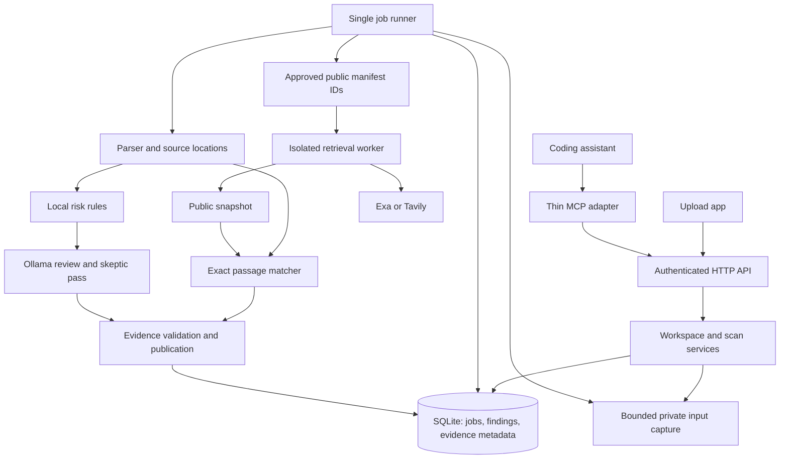

# Shared engine: implementation plan

Status: proposed design, ready for implementation review. No server, MCP adapter, application, migrations or tests have been implemented. This document specifies the first backend build for [Tracefold](../PLAN.md); API names below are proposed contracts, not frozen interfaces. No deployment is part of this planning task.

## 1. Outcome and scope

Build one server that owns workspace authorization, input capture, scan execution, evidence, findings and rechecks. The upload app and MCP integration are clients of this server. Neither client parses documents, calls the model directly, assigns severity or maintains a separate findings database.

The first completed backend must let two authenticated clients submit/read the same workspace scan and observe the same versioned finding. It must process a controlled public-copy fixture, an unpublished risky file and its corrected version without a UI or coding assistant being required.

Required: local uploads and registered local workspaces, TXT/Markdown/code and DOCX extraction, exact public-passage matching, bounded local risk checks, Ollama context review, one live public retrieval adapter, asynchronous jobs, cancellation, evidence validation, recheck and access control.

Later: remote GitHub/Docs connectors, scheduled monitoring, file watchers/editor diagnostics, edited/paraphrased matching, dependency/CVE remediation, takedown submission, automatic patches, multi-company hosted deployment and distributed workers. Preserve extension points without building these systems now. Git change selection for a registered local repository is required for the later MCP adapter; remote GitHub OAuth is not.

## 2. Implementation decisions

| Area | Decision | Reason |
|---|---|---|
| Language | Python 3.11+, managed with uv | Fits the existing plan and keeps one backend language. |
| HTTP boundary | FastAPI + Pydantic request/response models | One validated contract, exported as OpenAPI for both clients. |
| Persistence | One SQLite database, schema migrations, short transactions | Jobs and history survive restart without Redis/Postgres infrastructure. |
| Execution | One API process and one supervised scan loop, one active scan initially | Easy to inspect; no duplicate worker ownership or unbounded model concurrency. |
| Public retrieval | Separate restricted process, no private mounts or model context | Public retrieval accepts only approved manifest entries. |
| Models | One pinned local Ollama model, JSON-schema outputs and validation | Review is an optional stage; deterministic evidence survives model failure. |
| Transport | App uses HTTP; later MCP stdio adapter forwards to the same HTTP API | MCP hosts do not start a second engine or open the database. |
| Updates | Poll job/status endpoints first | Avoid WebSocket/SSE complexity until the core works. |
| Fixes | Read-only scanning; return suggested changes and a recheck target | Applying a patch belongs to the user's editing workflow. |

Initial development binds the service to loopback. Strict-private execution is on the workstation or in a company-trusted environment. Per the workspace convention, an actual request to deploy to the “server” means the Agent VPS; this plan does not deploy there. Uploading workstation material to that VPS would leave the workstation, and that deployment needs an explicit trust-boundary description rather than a local-only claim.

## 3. Components and ownership



Suggested layout once implementation begins:

```text
server/
  tracefold/
    api/             # routes, auth, error mapping; no detection logic
    contracts/       # Pydantic DTOs and versioned enums
    services/        # workspace, submission, findings, rechecks
    jobs/            # claim, run, cancel, deadline, recovery
    inputs/          # upload capture, safe filesystem reader, Git selection
    parsing/         # text/code/DOCX extraction with stable locations
    checks/          # deterministic rules and match algorithms
    analysis/        # local-model prompts, validation, skeptic review
    retrieval/       # isolated worker entry point and provider adapters
    gateway/         # outbound policy, deadlines, redacted ledger
    storage/         # repositories and migrations
    policy/          # workspace grants and response disclosure
  tests/             # contract, boundary, job, matching and recheck tests
  fixtures/          # tiny synthetic public/private examples
adapters/mcp/        # later: tool-to-HTTP mapping only
```

Only storage code performs SQL. Only the gateway performs HTTP, including loopback Ollama calls with a distinct local policy. Network checks supplement OS-level isolation; a Python module boundary is not a sandbox. All callers use the same service authorization and response policy. Credentials and raw text never appear in ordinary logs or exceptions.

## 4. Authorization and deployment boundaries

Provision workspaces and client grants through local operator configuration/CLI in the first build. A client cannot register an arbitrary filesystem root or escalate its own permissions through scan arguments. Generate high-entropy client tokens, keep their hashes server-side, and load secrets from local protected configuration. Token values never appear in URLs, tool output, source control or logs.

Each client grant binds allowed workspace IDs, capabilities (`submit`, `read`, `read_evidence`, `recheck`, `cancel`, `review`) and disclosure policy. Check ownership through all nested IDs: a scan ID, document ID or evidence ID from another workspace must not bypass access control. Return a non-enumerating not-found response for inaccessible resources. The first release has one company, but test two isolated workspaces.

Bind loopback, reject unexpected Host and browser Origin values, and configure an explicit browser-origin allowlist. Require authorization on reads and mutations, including the ledger. CORS alone is not authentication. Never accept caller-provided provider credentials, raw arbitrary fetch URLs, model endpoints or shell commands in a scan body. Public manifests are operator-approved resources.

The MCP client is a separate disclosure boundary. Strict-private mode requires a locally configured model host; the server cannot infer the host's real model routing from an MCP connection. An operator must select and verify that deployment. Cloud-backed hosts receive only the explicitly permitted minimal response; even titles, paths and risk descriptions can disclose information. Do not advertise cloud-host integration as “nothing private leaves.” No unrestricted raw-file MCP tool is required.

## 5. Input capture and provenance

Every scan processes immutable captured bytes, never a mutable file read independently by each stage. For a registered workspace, reject path traversal, outside-root symlinks, special files and excluded paths; validate at open time, not just when accepting a filename. Use server-owned opaque IDs and do not trust uploaded filenames as storage paths.

For local changes, resolve an explicit baseline commit object (not an interpolated shell string), inventory staged/unstaged changes and optionally permitted untracked files, and capture current content once. Review current saved files against the baseline, not an imagined future commit. Use fixed Git operations without shell evaluation or user-defined diff/textconv helpers; do not run hooks, imported code or dependencies. Include bounded surrounding context, and report omitted cross-file context. A concurrent change during capture produces a conflict/retry requirement rather than mixed-version evidence. Deleted or renamed files are recorded as such; missing bytes alone do not establish a fix.

Initially support UTF-8 text/code and DOCX. DOCX is parsed as data with compressed/uncompressed size and entry-count limits; no macros, external relationships or executable content. Unsupported formats, decoding failures and oversized inputs are individually reported.

Use SHA-256 internally for byte identity and a canonical, sorted manifest digest for the input revision. Digests remain private metadata, not public queries or client authorization tokens. Text locations use zero-based Unicode-code-point offsets, end exclusive; code also supplies derived one-based line numbers. DOCX uses paragraph IDs and offsets in extracted paragraphs, not fabricated Word page numbers. Record parser and normalization versions and map match spans back to original extracted text.

**Retention decision:** private content is ephemeral by default. Upload endpoints must parse bounded multipart data without disk-spooling raw bytes in this mode; keep captures in a bounded in-memory registry. Return an expiry time. Queued jobs referencing expired input fail explicitly with `input_expired`; a restart invalidates these captures. Local-workspace content can be recaptured in a new scan, not silently substituted into an old one. Persist only opaque file IDs, hashes, locations and sanitized findings by default. Source text for evidence display must still exist in memory, be re-uploaded with the same hash, or be re-read from an authorized file whose hash matches. Otherwise report `evidence_unavailable`, never show current text as historical evidence.

Opt-in durable private snapshots are later work with an explicit storage/retention policy. The MVP does not promise that uploaded plaintext survives restart. Before persistence, validate and sanitize model-generated titles, conditions and fix text too; any free text may echo private input. Persist bounded templates and safe structured fields where possible; keep unverified free-form explanation ephemeral. Never claim this filter alone is universal data-loss prevention.

## 6. Canonical records

All records carry `schema_version`; all timestamps are UTC. IDs are server-generated and workspace-scoped on access.

| Record | Important fields |
|---|---|
| Workspace | ID, registered root/source type, allowed files, privacy policy version, revision counter |
| Input snapshot | Workspace, capture ID, manifest digest, per-file IDs/hashes/sizes, source baseline, parser version, expiry |
| Public snapshot | Manifest version, requested source IDs, per-source URL, retrieval time/status, content hash, text blob reference, fresh/cached status |
| Scan | Workspace, input/public snapshot IDs, requested checks, versions, state, stages, coverage, deadline, budget counters, initiator, revision sequence |
| Finding | Stable ID, workspace, kind (`public_exposure` or `local_risk`), check ID, human review state, first/last observation |
| Observation | Finding + scan, input version, evidence refs, check/model/prompt versions, detection/review outcome, conditions and uncertainty |
| Evidence | Input location and hash; public source/span for matches; deterministic rule IDs or validated local context for risks |
| Recheck | Target finding/observation, new scan ID, outcome, reason, versions compared |
| Ledger event | Scan, destination category, purpose, approved source ID, time/status, masked payload summary; no private text or credentials |

Keep detection, human review and recheck separate. Suggested enums:

- Risk review: `supported`, `inconclusive`, `dismissed`, `unavailable`; “supported” means supported by reviewed source, not runtime-confirmed.
- Human review: `unreviewed`, `acknowledged`, `dismissed` with a reason; dismissal does not delete evidence.
- Recheck: `still_detected`, `not_detected_in_checked_version`, `inconclusive`.
- Coverage per requested check/source/file: `complete`, `partial`, `failed`, `not_requested`, with reason and counts.

Finding correlation begins conservatively: same workspace, file identity, check and normalized evidence anchor. Do not deduplicate solely by title or line number. Keep occurrence observations when lines move; uncertain rename/anchor correlation creates a new candidate link instead of merging unrelated risks. Rechecks explicitly reference the old finding and do not require a heuristic match to establish their scope.

## 7. Jobs and state transitions

`queued → running → completed | partial | failed | cancelled | interrupted`

Completed means all requested stages finished within their defined coverage; it never means no risks. Partial means usable results exist but a requested stage or part of coverage did not finish. Unsupported/skipped requested files appear in coverage and prevent a whole-input completion claim. Failed means no usable requested analysis completed. Cancellation retains completed observations as partial evidence without a success verdict.

1. Validate authorization, requested capabilities, input capture and manifest; accept a short request and return a job ID.
2. Atomically claim the job using a database transaction. Use one runner initially and refuse multi-runner startup until leasing is implemented.
3. Parse the captured files; fetch/reuse a clearly dated public snapshot only if public matching was requested.
4. Run exact matching and local rules independently. A retrieval failure cannot disable a local rule; Ollama failure cannot delete a deterministic match.
5. Run bounded model context review and skeptical review on candidates. Validate schema, evidence references and privacy before publishing.
6. Commit observations and coverage transactionally. Update “current” views only if the scan's workspace revision is still current. A stale scan remains visible as history and cannot clear a newer issue.
7. Publish terminal state and budget usage. A UI disconnect does not cancel the job; cancellation is explicit.

Use SQLite-backed job state, not a bare after-response callback as the job record. On restart mark previously running jobs interrupted; queued jobs needing expired ephemeral input require resubmission. Do not silently replay billed provider calls or retry input against changed workspace bytes. An explicit new job may reuse verified public blobs but records new lineage.

Accept an `Idempotency-Key` scoped to client/workspace. Same key and canonical payload returns the original job; conflicting payload returns 409. Optional coalescing only merges scans with identical input, public snapshot/freshness requirement, checks, versions and privacy policy. Never reuse an old negative result for a new revision.

## 8. Proposed HTTP contracts and MCP mappings

Prefix all routes with `/v1`. Validate schemas, use opaque IDs and paginate findings/events (default 50, max 100). Long operations return 202; clients poll. Do not hold an MCP tool request open for a five-minute scan.

| Endpoint | Purpose | Future MCP mapping |
|---|---|---|
| `GET /health` | Liveness only, no secrets | None |
| `GET /capabilities` | Authorized readiness, supported checks, limits, model availability | `get_capabilities` |
| `GET /workspaces` | Only the client's granted workspaces | `list_workspaces` |
| `POST /workspaces/{id}/uploads` | Bounded multipart capture → input ID, expiry and accepted/rejected files | App only initially |
| `POST /workspaces/{id}/captures` | Capture selected registered files or changes against baseline → input ID | Used inside `scan_changes` |
| `POST /workspaces/{id}/scans` | Queue scan for an existing capture | `scan_changes` orchestrates capture + submission |
| `GET /workspaces/{id}/scans/{scan_id}` | Job, stages, per-check coverage, freshness and errors | `get_scan` |
| `POST /workspaces/{id}/scans/{scan_id}/cancel` | Request cooperative cancellation | `cancel_scan` |
| `GET /workspaces/{id}/findings?scan_id=...` | Paginated observations for a specific scan | `get_findings` |
| `GET /workspaces/{id}/findings/{finding_id}` | History and authorized explanation/evidence references | `explain_finding` |
| `GET /workspaces/{id}/evidence/{evidence_id}` | Policy-gated evidence; unavailable if source bytes expired | Included only under permitted MCP policy |
| `POST /workspaces/{id}/findings/{finding_id}/rechecks` | Queue scoped recheck against a new capture | `recheck_fix` |
| `PATCH /workspaces/{id}/findings/{finding_id}/review` | Human review state/reason with expected version | Later optional tool |
| `GET /workspaces/{id}/scans/{scan_id}/ledger` | Redacted request accounting | App initially |

Scan request example (illustrative IDs):

```json
{
  "input_id": "input_example",
  "checks": ["public_match", "local_risk"],
  "public_sources": {"manifest_id": "sources_main", "mode": "refresh"},
  "review_profile": "data_exposure_v1"
}
```

Response: `{ "scan_id": "scan_example", "state": "queued", "input_id": "input_example", "status_url": "/v1/workspaces/ws_main/scans/scan_example" }`.

For a local-risk-only request, omit public sources and report public exposure as `not_requested`, not “no match.” `refresh` and `snapshot` modes are explicit; snapshot mode requires a known snapshot ID. Failed refresh must not silently claim cached evidence is fresh.

Error envelope: `{ "error": { "code": "input_expired", "message": "Upload this input again to scan it.", "retryable": false }, "request_id": "..." }`. Use 401 for invalid authentication, 404 for absent/inaccessible resources, 409 for revision/idempotency conflicts, 413 for size, 422 for invalid contracts and 429 for full queue. Stage/provider errors belong to the job result, not a misleading HTTP 200 “clean” result. Messages contain no raw provider responses, filesystem roots, prompts or secrets.

The MCP adapter exposes validated tool inputs and structured results, preserves server error codes and sends a grant held in local configuration. It must not accept a host-supplied server URL, token, workspace root or arbitrary network query. `explain_finding` reads the stored explanation rather than generating a contradictory second answer. Tool annotations and host prompts are usability aids, not enforcement.

## 9. Detection and recheck behavior

Exact matcher: versioned normalization, candidate shingles, actual-text span confirmation, meaningful minimum passage size, boilerplate handling and original offsets. Keep thresholds in versioned configuration and freeze before evaluation. Report overlap, not proof of unauthorized publication. Edited matching is deliberately excluded from the first implementation milestone.

Local rules: start with apparent secret literals and sensitive logging patterns in one declared supported code language (Python initially), plus structured document sensitive-content candidates. Clearly report unsupported languages and context. Regex alone cannot establish exploitability; model review may identify counterevidence but cannot erase raw detector provenance. Choose synthetic values that look relevant without being real credentials.

Ollama: send bounded local context and explicit evidence IDs, ask for structured candidate/review output, validate again server-side, allow at most one schema-repair retry within the shared budget. Reject invented locations and uncited statements. Pin model/check/prompt identities. If the needed tokenizer/model identity cannot be established, mark model analysis unavailable rather than bypassing limits. No shell, arbitrary tool invocation, credential validation, cloud fallback or code execution.

Recheck: require an old observation and a new capture; run the same check/version across the relevant current file with bounded context. An inaccessible, deleted, unsupported, truncated or differently configured input produces inconclusive unless an explicit removal-specific check can establish the intended property (deferred). Only complete equivalent coverage may produce `not_detected_in_checked_version`. Do not label this comprehensive “fixed.” A local recheck never closes public-copy evidence; that requires a successful fresh retrieval and equivalent public comparison.

## 10. Resource and retention limits

These are proposed hard pilot limits, not measured performance claims:

- One active scan, at most four queued scans, one concurrent Ollama call and at most two public HTTP calls.
- At most 10 private files, 5 MB compressed/upload bytes per file, 20 MB total request bytes and 10 MB total extracted text per capture. Bound DOCX expansion/entry counts separately before allocation. At most two private captures, 40 MB captured raw bytes total plus 20 MB extracted text, expiry 15 minutes after capture or scan completion; active capture must be pinned until its five-minute deadline. Reject capacity overflow instead of spilling raw text to disk.
- At most 20 public pages, 200 KB extracted text per page, 40 provider requests, 50 MB public cache, five-minute deadline per scan.
- At most 10 model candidates, 25 model requests, 40,000 cumulative input tokens and 2,000 output tokens per request, all also constrained by the chosen model's context window. Stop before exceeding a budget and show omitted coverage.
- One public content blob per hash; small per-scan references. Keep default metadata for the latest 100 scans/30 days, whichever is smaller, with explicit user retention overrides and no eviction of active jobs. Keep the latest three disposable sanitized debug traces; no raw prompts.

Measure disk/RAM and one small timing pilot before choosing model weights or raising limits. Download one model once; never duplicate databases/workspaces per finding. Bound ledger events per scan and remove only known disposable artifacts. Memory limits do not promise elimination of OS swap/crash dumps; avoid claiming forensic erasure. Durable user-approved evidence must not be deleted as “cache.”

## 11. Implementation milestones and acceptance gates

| Order | Deliverable | Acceptance gate |
|---|---|---|
| 1 | Contracts, SQLite migrations, workspace grants, queue and capture registry | Two clients share one job; cross-workspace access denied; restart/expiry/cancel behavior explicit. |
| 2 | Text/code parser, exact matcher, deterministic logging rule, fixture public adapter | Positive passage shows real source locations; unrelated/same-topic negative stays negative; invalid inputs remain incomplete. |
| 3 | Recheck and finding history | Corrected synthetic file no longer triggers the scoped rule; stale scans cannot overwrite current findings; public exposure stays open. |
| 4 | DOCX parser and local Git change capture | Paragraph evidence, safe size bounds, staged/unstaged/untracked selection and concurrent-change rejection verified. |
| 5 | Isolated live retrieval and gateway | One approved live source works; private marker never enters provider requests; redirects/invalid destinations rejected; failures preserve local checks. |
| 6 | Local Ollama review | Structured, source-grounded output; fabricated evidence rejected; timeout/model absence preserves deterministic results; budgets enforced. |
| 7 | Integration handoff | One documented fixture flow exercises all endpoints; exported OpenAPI and client examples allow app/MCP implementation without engine changes. |

Implementation starts with milestones 1–3. Do not build the UI or MCP adapter first; test their future calls with two HTTP clients. Only after the shared contract works should the clients be built against it. Live-provider and real-model checks are separately marked opt-in tests, not hidden requirements for offline CI.

Core regression cases: copied passage, same-topic non-copy, boilerplate, risky logging and masked counterpart, invalid evidence span, prompt injection as inert input, failed retrieval, missing Ollama, scan cancellation, restart with expired uploads, path/symlink escape, unauthorized IDs, request limits, stale completion and recheck scope. Adapter parity checks use deterministic fixtures or the same persisted result; independent model runs need not produce identical prose.

Strict-private acceptance additionally requires an observed network-denial test of the private runtime, isolated worker permissions and a local-model MCP host when that adapter is built. Unit tests of the gateway alone cannot establish the deployment privacy claim.

## 12. Reuse and references

Use the existing [0sec research note](../research/0sec-risk-review.md) for lead structure, finding validation and separate skeptical review. Keep Python; port only small reviewed behaviors rather than pulling the TypeScript monorepo into the server. No upstream code is copied by this planning task. Any later copied/ported code must record its pinned origin and retain applicable license notices, with tests for our stricter evidence/egress rules.

Primary documentation consulted for this plan:

- [FastAPI background tasks](https://fastapi.tiangolo.com/tutorial/background-tasks/): after-response work is available; the durable queue/state/recovery design above is our application decision.
- [Ollama structured outputs](https://docs.ollama.com/capabilities/structured-outputs): schema-constrained output plus application-side validation; schema validity is not evidence correctness.
- [MCP tools specification, 2025-06-18](https://modelcontextprotocol.io/specification/2025-06-18/server/tools): tool schemas and results. Confirm the selected SDK/host protocol compatibility when the adapter is implemented; this document does not mandate an obsolete SDK version.

The engine is complete only when its acceptance gates pass. At this stage these remain planned behaviors, not verified capabilities.
